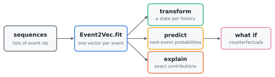
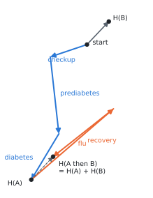
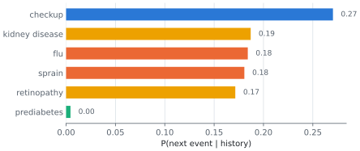
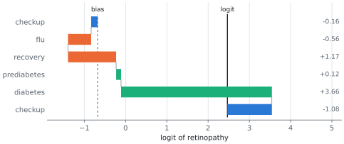
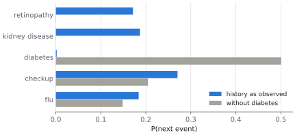
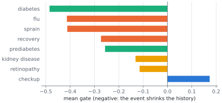
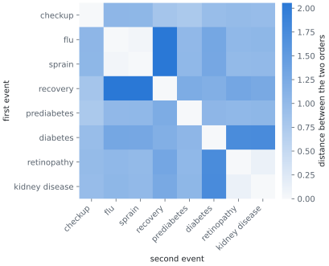
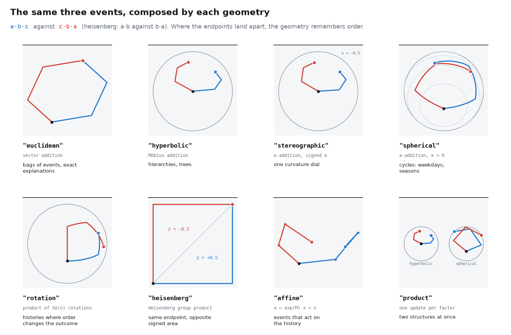

# event2vec in pictures

Event2Vec learns one vector per event type and represents a whole history as the
composition of its events. This guide walks through what that buys you, one
picture at a time. Every picture is computed by the library on a small synthetic
patient data set with known rules: flu and sprains are followed by recovery, and
prediabetes leads to diabetes and then to retinopathy or kidney disease.
`python docs/make_figures.py` regenerates all of them.

- [0. The big picture](#0-the-big-picture)
- [1. A history is a sum](#1-a-history-is-a-sum)
- [2. Predicting the next event](#2-predicting-the-next-event)
- [3. Explaining a prediction](#3-explaining-a-prediction)
- [4. What if](#4-what-if)
- [5. Events that forget](#5-events-that-forget)
- [6. When order matters](#6-when-order-matters)
- [7. Choosing a geometry](#7-choosing-a-geometry)
- [Glossary](#glossary)

---

## 0. The big picture

<picture>
  <source media="(prefers-color-scheme: dark)" srcset="figures/pipeline-dark.svg">
  
</picture>

The input is a list of sequences, each a list of integer event ids. `fit` learns one
vector per event type. Everything else follows from those vectors: a history's state
is their composition, the next event is predicted from the state by a linear
decoder, and because the state is built from the events in a fixed way, every
prediction can be split back into the events that produced it.

```python
from event2vector import Event2Vec

EVENTS = ["checkup", "flu", "sprain", "recovery", "prediabetes", "diabetes",
          "retinopathy", "kidney disease"]
# sequences: a list of lists of ids, e.g. [[0, 1, 3, 4, 0, 5], ...]
model = Event2Vec(num_event_types=len(EVENTS), embedding_dim=16, gate="vector",
                  max_norm=1e6, pad_sequences=True, num_epochs=40, random_state=0,
                  device="cpu").fit(sequences)
```

`docs/make_figures.py` contains the generator of the synthetic `sequences` used here.

---

## 1. A history is a sum

<picture>
  <source media="(prefers-color-scheme: dark)" srcset="figures/sum-dark.svg">
  
</picture>

In the default Euclidean geometry each event adds its vector to the state, so a
history is a path of event vectors from the start, and its state is the endpoint.
This model was trained with two dimensions so that the vectors can be drawn as they
are. History A (checkup, prediabetes, diabetes) ends at `H(A)`; appending history B
(flu, recovery) moves the state by exactly `H(B)`, so `H(A then B) = H(A) + H(B)`.

The picture also shows what the model learned. Flu is a long vector, but recovery
points almost the opposite way, so an illness followed by recovery leaves only a
short net trace (length 0.80, against 2.72 for flu alone).

```python
import numpy as np

states = model.transform(sequences)                  # one state per history
E = model.model.embedding.weight.detach().cpu().numpy()  # one vector per event
# without a gate or clipping, a state is exactly the sum of its event vectors
```

With `gate="vector"` the state becomes a weighted sum instead (section 5), and with
the default `max_norm=10.0` long histories are rescaled by norm clipping;
`max_norm=1e6` effectively disables it.

---

## 2. Predicting the next event

<picture>
  <source media="(prefers-color-scheme: dark)" srcset="figures/predict-dark.svg">
  
</picture>

After the history *checkup, flu, recovery, prediabetes, diabetes, checkup*, the model
expects another checkup (0.27), one of the two diabetic complications (0.19 for
kidney disease, 0.17 for retinopathy), or a new acute episode. It gives prediabetes
almost no chance (0.004): in this data, prediabetes never comes after diabetes.

```python
history = [0, 1, 3, 4, 5, 0]                    # the ids of the history above
probs = model.counterfactual(history)["probs"]  # P(next event | history)
```

---

## 3. Explaining a prediction

<picture>
  <source media="(prefers-color-scheme: dark)" srcset="figures/explain-dark.svg">
  
</picture>

Why does the model expect retinopathy? Because the state is a sum and the decoder
is linear, the logit of retinopathy splits into the decoder bias plus one term per
event in the history, with nothing left over. Starting from the bias (−0.68), each
lane adds one event's contribution and the last lane ends exactly at the logit
(2.47). Diabetes contributes +3.66, almost all of it.

```python
out = model.attribute(history, target=6)        # 6 = retinopathy
out["baseline"] + out["contributions"].sum()    # equals out["logit"] exactly
model.rank_causes(history, effect=6)          # [(event_id, score), ...], diabetes (5) first
```

The contributions explain the *model's* prediction, not causation. Recovery gets
+1.17 here although the data generator has no rule linking recovery to
retinopathy: it is an association the model picked up from the data, and the
decomposition shows it plainly instead of hiding it.

---

## 4. What if

<picture>
  <source media="(prefers-color-scheme: dark)" srcset="figures/whatif-dark.svg">
  
</picture>

A counterfactual edits the history and runs the model again. Removing diabetes
makes both complications almost impossible (retinopathy drops from 0.17 to 0.0004)
and makes diabetes itself the most likely next event (0.50): the patient is back at
prediabetes, which in this data is followed by diabetes.

```python
cf = model.counterfactual(history, remove=[4])  # remove position 4 (diabetes)
cf["probs"], cf["probs_counterfactual"], cf["delta"]
# also: replace={position: event_id}, insert=[(position, event_id)]
```

Counterfactuals re-encode the edited history, so they are exact for every geometry.

---

## 5. Events that forget

<picture>
  <source media="(prefers-color-scheme: dark)" srcset="figures/forget-dark.svg">
  
</picture>

With `gate="vector"`, each event may rescale the history before adding its vector:
`h_t = (1 + g_e) * h_{t-1} + e_t`. A negative gate means the event makes the past
matter less for what comes next. The model learned that diabetes (−0.48) and acute
episodes such as flu and sprain (−0.41) reset much of the history, while a checkup
(+0.17) keeps it. The gate starts at zero, so training starts from the plain sum,
and the reconstruction loss pulls every gate back towards zero unless prediction
needs it.

```python
gates = model.event_gates()          # (num_event_types, embedding_dim)
gates.mean(axis=1)                   # one number per event, as in the picture
```

---

## 6. When order matters

<picture>
  <source media="(prefers-color-scheme: dark)" srcset="figures/order-dark.svg">
  
</picture>

A sum does not care about order: without a gate, *flu then diabetes* and
*diabetes then flu* reach exactly the same state (distance 0). With the gate they
differ by `g_b * e_a - g_a * e_b`, and the heatmap shows by how much for every pair.
The pairs the model treats as most order-sensitive are an acute episode against its
recovery and diabetes against its complications: the pairs whose order the data
generator fixes.

```python
h_ab, h_ba = model.transform([[1, 3], [3, 1]])   # flu, recovery in both orders
np.linalg.norm(h_ab - h_ba)
```

---

## 7. Choosing a geometry



The Euclidean sum is one choice of composition. Every geometry composes the same
three events here, in the order a·b·c (blue) and c·b·a (red); where the two
endpoints separate, the geometry remembers order. Hyperbolic space suits
hierarchies, the sphere suits cycles, rotations and the Heisenberg group record
order, and the affine group lets events act on the whole history. All share the
same estimator; where composition is not a sum, `attribute` returns path
contributions, which also add up to the logit exactly.

```python
Event2Vec(num_event_types=len(EVENTS), geometry="hyperbolic", curvature=1.0)
Event2Vec(num_event_types=len(EVENTS), geometry="rotation", rotation_n=3)
Event2Vec(num_event_types=len(EVENTS), geometry="affine")
```

---

## Glossary

| term | meaning |
|---|---|
| event vector | the learned vector `e` of one event type (`model.model.embedding.weight`) |
| state | the composition of a history's event vectors, `h_t` (`model.transform`) |
| decoder | the linear map from a state to next-event logits |
| contribution | one event's exact share `φ_i` of a logit (`model.attribute`) |
| counterfactual | the prediction for an edited history (`model.counterfactual`) |
| gate | how much an event rescales the history, `g_e` (`model.event_gates`, needs `gate=`) |
| geometry | the operation that composes a state with an event (`geometry=`) |

See the [README](../README.md) for installation, the full API and the FAQ.
